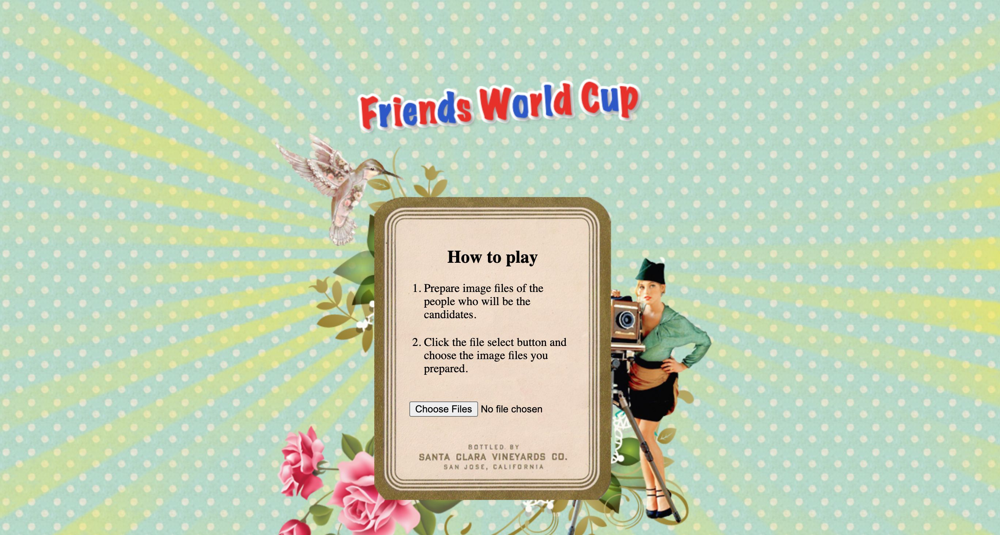
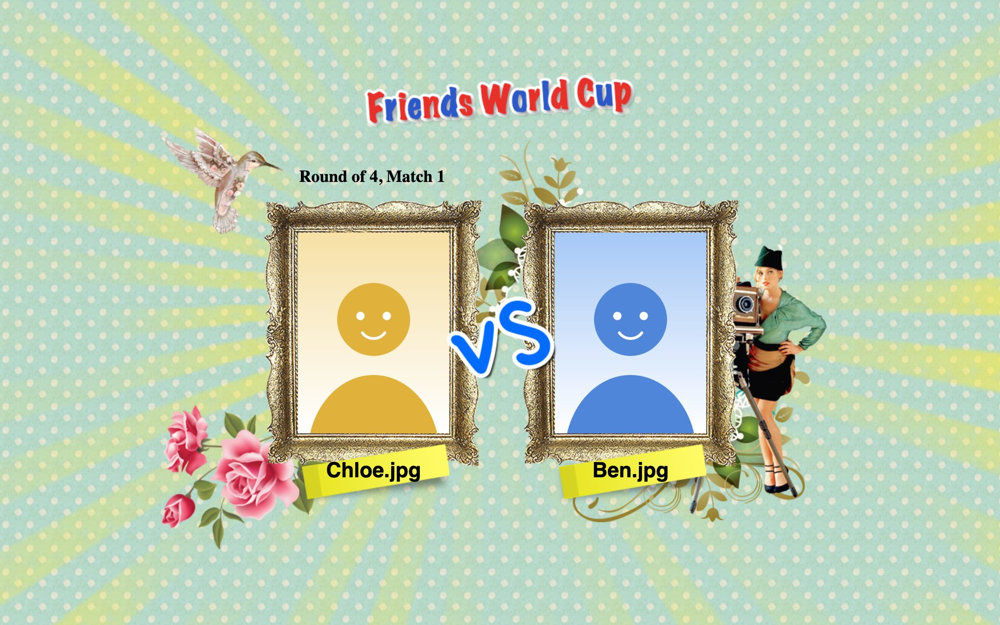
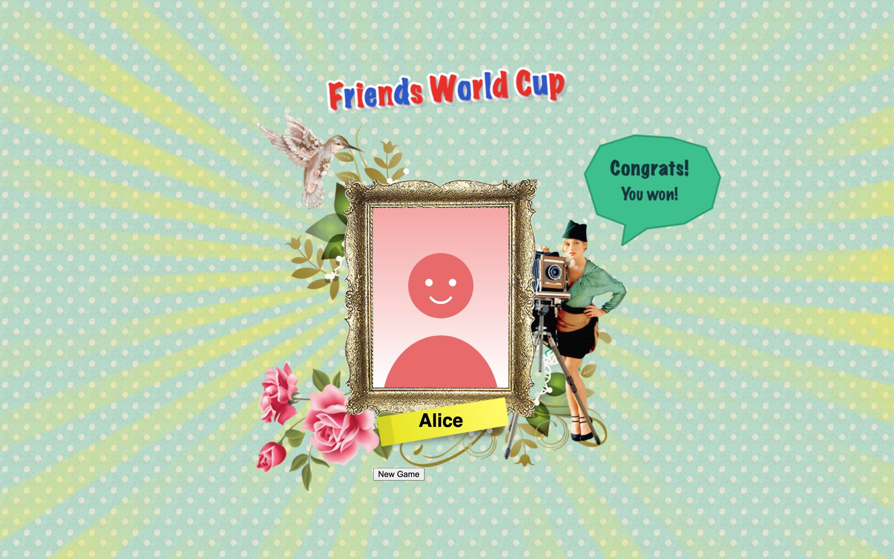

# friends-worldcup

A web-based "friends world cup" game. Pick photos of your friends (or your ideal types) from your own computer and play a fun tournament to find your favorite.

It can also be installed as a Chrome extension:

<https://chrome.google.com/webstore/detail/nlcmnbcpdocigdogindcaoejejedbfnb>

## Usage

- Click the file select button and choose photos. (You must select at least 2 files.)
- The tournament (final, semifinals, quarterfinals, round of 16) is built automatically according to the number of photos. Photos are picked at random.
- When the photos appear on the screen, choose one at a time to play the tournament.

## Features

- Play a friends / ideal type world cup game
- Uses photos from your own computer
- The round of 16, quarterfinals, semifinals, and final are selected automatically to match the number of photos

## Screenshots

## Release Notes

### v1.1.0

- Removed the 16-photo minimum limit
- Added a "New Game" button after a game ends

### v1.0.0

- Initial release

---

Designed by su, Programmed by Ted
